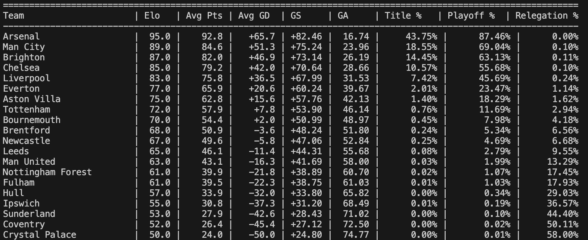

# Soccer-League-Simulator

A soccer league simulator written in Java that predicts season outcomes using Elo ratings,
Poisson-distributed goal scoring, and Monte Carlo simulation. Users build a custom league
of any size, and the program plays thousands of simulated seasons to report each team's
long-run fortunes: championship probability, playoff and relegation odds, average points,
goal difference, and goals scored/conceded. A head-to-head mode simulates a single matchup
thousands of times for quick "what happens when these two meet?" questions.



## Features

- **Elo-based team ratings** — each team carries a 0–100 rating; win expectations are
  computed with the standard Elo formula, scaled for the compact rating range
- **Poisson goal engine** — each team's expected goals derive from the rating gap between
  the two sides, then actual goals are drawn from a truncated Poisson distribution, so
  scorelines like 1–0 grinds and 4–3 shootouts emerge naturally with correct frequencies
- **Full league play** — configurable round-robin (1 = single, 2 = home-and-away) with
  in-season Elo updates using win/draw/loss expectations
- **Monte Carlo season simulation** — thousands of independent seasons with per-season
  stats reset and cross-season tallies accumulated (titles, playoff appearances,
  relegations, average points/GD/goals)
- **Real-table tiebreakers** — standings and champion detection resolve ties by points →
  goal difference → goals scored, matching real league rules
- **Full season-preview table** — formatted output showing Elo, average points, average
  goal difference, average goals for/against, title %, playoff %, and relegation % for
  every team
- **Head-to-head matchup tool** — enter any two teams and simulate their fixture N times;
  reports win/draw/loss percentages and the average scoreline

## How It Works

The project separates responsibilities across three classes. `Team` holds one club's
state — ratings, season stats (points, W/D/L, goals), and cross-season Monte Carlo
accumulators. `LeagueSimulator` orchestrates everything league-level: user input, the
round-robin schedule, per-season simulation, and the final reporting table. `Maths` is a
pure-math utility class containing the Elo win-expectancy formula, the Poisson goal
sampler, and the expected-goals model.

Goal generation works in two layers: a *distribution* layer converts each team's rating
into an expected-goals value λ (stronger teams attack more; facing a stronger defense
suppresses your λ), and a *sampling* layer draws actual goals from the Poisson
probabilities P(0) through P(5) using a weighted number-line roll. Match results then
fall out of the scoreline, and Elo ratings update by K × (actual − expected), so upsets
move ratings far more than expected results.

The Monte Carlo loop resets every team before each simulated season, captures season
totals for averaging, and tallies championships, playoff spots (top N), and relegation
(bottom N) — so each percentage column reflects thousands of independent seasons played
from the same starting ratings.

## Project Structure

| File | Purpose |
|---|---|
| `Runner.java` | Program entry point: mode selection (full league / head-to-head) |
| `LeagueSimulator.java` | League orchestration: input, schedule, season simulation, Monte Carlo loop, standings table |
| `Team.java` | Team model: ratings, match recording, season stats, cross-season accumulators |
| `Maths.java` | Math engine: Elo odds, expected-goals model, Poisson sampler |
| `README.md` | This file |

## Getting Started

Compile and run:

```bash  
javac -d bin *.java
java -cp bin Runner
```
## Future Work

- **Gap-sensitive draw probability** — real leagues see more draws between evenly matched
  teams and fewer in mismatches. Replace the implicit draw rate with a formula that narrows
  as the rating gap widens , and condition
  the Poisson goal draws on the decided outcome so scorelines always match the result.
- **Home advantage** — award the home side a small Elo bonus (≈3 points) when computing win
  expectations and expected goals. With a home-and-away schedule every team hosts equally,
  so league-wide averages stay fair while individual matches gain realistic home/away
  asymmetry.
- **Dynasty mode** — an optional mode where Elo ratings persist across seasons instead of
  resetting to their initial values. Strong teams would snowball as wins compound into
  rating gains, letting users watch dynasties form over hundreds of simulated years —
  trading clean Monte Carlo independence for long-run evolution.
- **Postseason tournament** — a knockout bracket for playoff seeds, decided by neutral-site
  games with no draws.
- **Scoreline histogram** — reporting the most common exact scorelines in head-to-head mode
  (e.g. "1–1: 18% of games"), to show whether a matchup tends toward grinds or shootouts.
